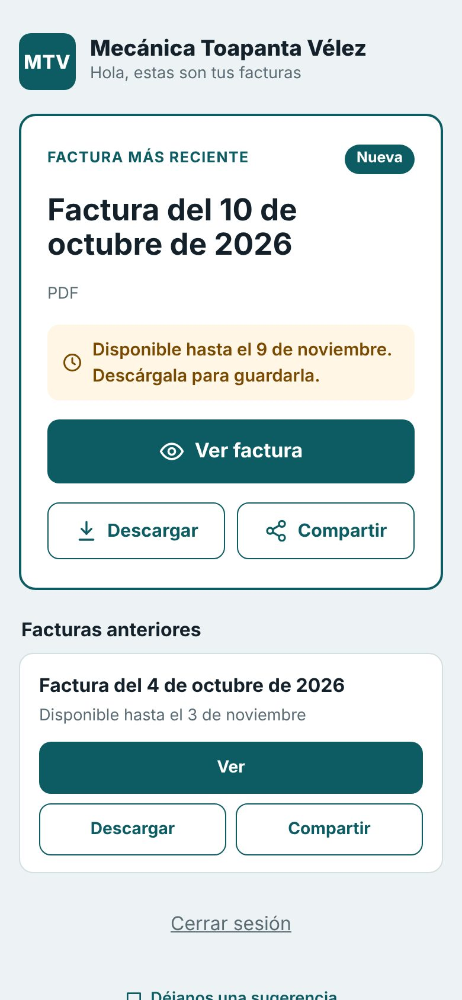
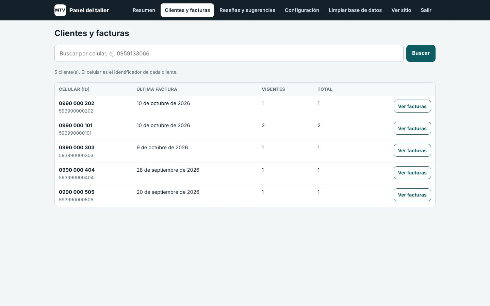

# Mecánica Toapanta Vélez · Sistema de facturas

Sistema real en producción para un taller mecánico: automatiza el envío de facturas a los clientes y les da un portal web para consultarlas.

**En producción:** [mecanicatoapantavelez.com](https://mecanicatoapantavelez.com)


## Capturas

**Portal del cliente: sus facturas en el celular**



**Panel del taller: clientes y facturas**



_Capturas tomadas con datos de prueba._

## Cómo funciona

1. **Monitor de facturas (Windows, Python).** Vigila la carpeta `C:\Facturas`; cuando aparece un PDF nuevo lo sube al portal y envía el enlace al cliente por WhatsApp, con un saludo según la hora del día. Reintenta los envíos fallidos y se instala como ejecutable con inicio automático.
2. **Portal de clientes (PHP + MySQL, Hostinger).** Cada cliente accede con un enlace seguro a su historial de facturas, puede descargarlas y dejar sugerencias.
3. **Panel de administración.** Gestión de clientes, facturas, sucursales, sugerencias y configuración; limpieza automática de facturas vencidas con un cron job.

## Estructura

```
1_Programa_Windows/    Monitor de facturas (Python, Tkinter, Selenium / WhatsApp Cloud API)
2_Pagina_Hostinger/    Portal de clientes y panel /admin (PHP 8, MySQL)
```

## Tecnologías

Python · Tkinter · Selenium · WhatsApp Cloud API · PHP 8 · MySQL · Cron · Hostinger

## Configuración

- Copia `2_Pagina_Hostinger/config.ejemplo.php` como `config.php` con los datos de tu base de datos.
- Copia `2_Pagina_Hostinger/public_html/lib/admin_secret.ejemplo.php` como `admin_secret.php` con el hash de tu contraseña inicial.
- Las instrucciones del programa de Windows están en `1_Programa_Windows/LEEME.md`.

Ningún archivo con contraseñas o claves reales forma parte de este repositorio.

---
Desarrollado por [Andersson Toapanta](https://anderssont-var.github.io/AnderssonT-var.github/)
